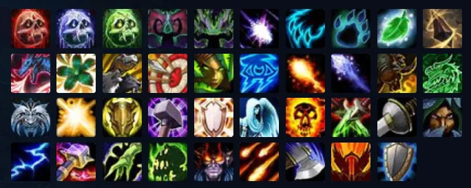

# Skills & rules for coding agents



Prompt assets for Claude Code, OpenCode, Codex CLI, Hermes Agent, [Pi](https://pi.dev/), [OMP](https://omp.sh/) and Antigravity.
One script installs them into all seven. **How FDD works: [afa7789.github.io/skills](https://afa7789.github.io/skills/)**.
v1 lives at tag [`v1.0.0`](https://github.com/afa7789/skills/tree/v1.0.0).

## Install

```bash
bash scripts/install-tools.sh          # Rust + dagRobin (>= 0.2.0)
bash scripts/sync-skills.sh --status   # dry run
bash scripts/sync-skills.sh            # sync every installed host (backups kept)
```

## Skills

| Skill | What it does |
|---|---|
| `fdd` | Brief or repo → feature graph → dagRobin tasks, each with one binary check |
| `dag-loop` | External driver: one worktree + headless agent per batch of ready tasks, checks decide done |
| `ux` / `visual-test` | Screenshot and fix the UI / record a click-through flow |
| `tdd` | Opt-in red → green → refactor when the project uses tests or you ask |
| `review` | PR review: spec check, bugs, trust boundaries, ponytail lens |
| `summarize` / `estimator` | Audit docs → `SUMMARY.md` / token, USD and calendar estimate |
| `prompt-refiner` / `peer-review` | Vague idea → brief / panel rewrites a document |
| `solidity-review` / `solidity-complex-audit` | Solidity checklist / full audit |
| `ste-docs` / `reader` | Simplified Technical English rewrite / proofreading |

Pipeline: `prompt-refiner` → `fdd` → `dag-loop` → `review`. herdr plugin: `bash scripts/herdr-install.sh`.

## Develop

```bash
git config core.hooksPath .githooks   # pre-push runs the gate
bash scripts/gate.sh                  # shellcheck + sync suite + skill tests + line budgets
```

New skill: `skills/<name>/SKILL.md` (≤ 100 lines). Tests in `skills/<name>/tests/` as `*.test.sh` or `*.e2e.mjs`.
